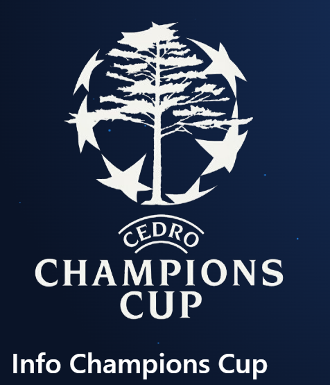
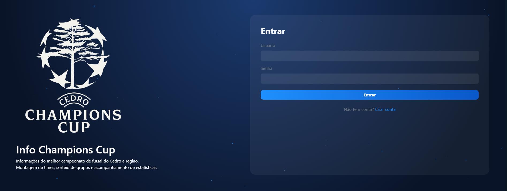
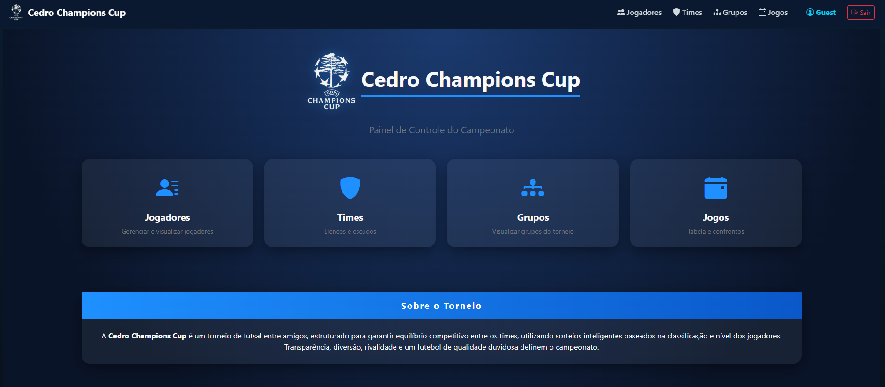
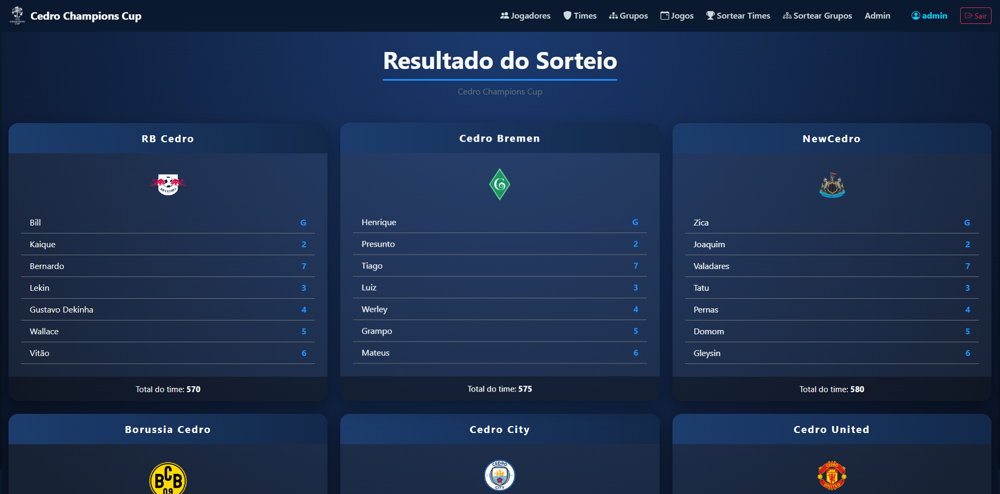
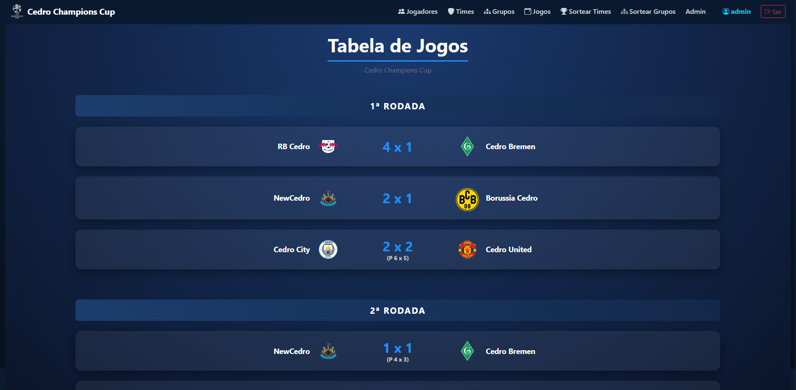

# ⚽ Info Champions Cup

<p align="center">
  
</p>

<p align="center">
  <b>Plataforma completa para organização de torneios de futsal, com sorteio inteligente de times e grupos, gerenciamento de jogadores e controle de partidas.</b>
</p>

---

## 📌 Sobre o projeto

Este sistema foi desenvolvido para facilitar a organização de torneios de futsal, permitindo o gerenciamento completo desde o cadastro dos jogadores até a definição dos confrontos.

A aplicação automatiza processos como sorteio de times e grupos, garantindo equilíbrio e praticidade na organização do campeonato. Além de reunir informações sobre o torneio, como informações de jogadores, equipes, grupos e jogos. Também armazena informações sobre campoenatos anteriores e estatísticas dos jogadores nos torneios.

---

## 🚀 Funcionalidades

* 👤 Cadastro de jogadores
* 🛡️ Cadastro de times
* 🏆 Criação de grupos
* 🎲 Sorteio balanceado de times
* 📊 Organização de confrontos
* 📅 Gerenciamento de jogos
* 📋 Visualização de tabelas e dados
* 🔐 Sistema de autenticação (login) e ambiente administrativo

---

## 🛠️ Tecnologias utilizadas

* Python
* Django
* HTML / CSS
* Bootstrap
* SQLite

---

## 📸 Preview do sistema

### 👤 Tela de login



### 🖥️ Tela inicial



### 🎲 Sorteio de times



### 📊 Tabela / Jogos



---

## ⚙️ Como rodar o projeto

```bash
# Clonar repositório
git clone https://github.com/OTavenriq/Sorteador-Champions-Cup.git

# Entrar na pasta
cd seu-repo

# Criar ambiente virtual
python -m venv venv

# Ativar ambiente
venv\Scripts\activate  # Windows
source venv/bin/activate  # Linux/Mac

# Instalar dependências
pip install -r requirements.txt

# Rodar servidor
python manage.py runserver
```

---

## 🎯 Melhorias futuras

* [ ] Sistema de evolução automática de overall por desempenho
* [ ] Exportação de tabelas (PDF/Excel)
* [ ] Dashboard com estatísticas
* [ ] Interface mobile responsiva

---

## 🤝 Contribuição

Este projeto não aceita contribuições diretas no código.

No entanto, sugestões, ideias e melhorias são bem-vindas!
Você pode abrir uma issue ou entrar em contato.

---

## 📄 Licença

Este projeto é de uso exclusivo do autor.  
Não é permitida cópia, modificação ou distribuição sem autorização prévia.

---

## 👨‍💻 Autor

Feito por **Otávio Henrique Gonçalves Ribeiro**

📧 [otaviohgribeiro@gmail.com](mailto:seuemail@email.com)
💼 LinkedIn: https://linkedin.com/in/otavio-ribeiro